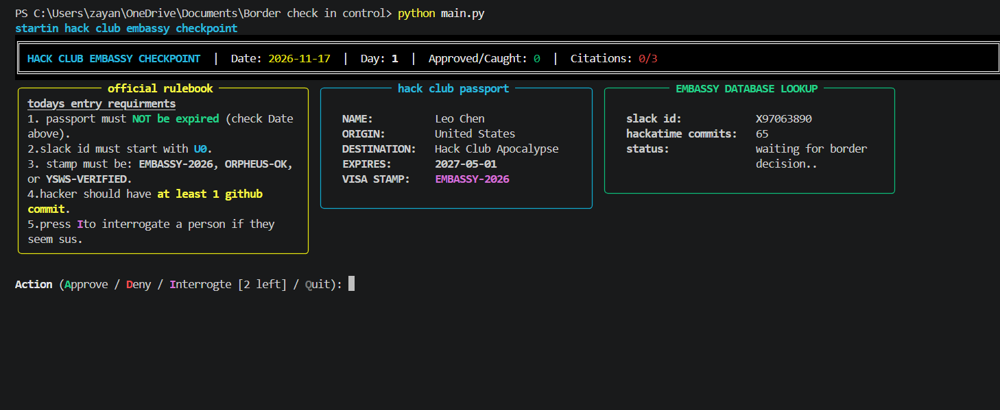

# border check-in control



## what is this & why did i build it?
**border check-in control** is a border-inspection game inspired by *papers, please*, built in python for **hack club embassy**. you play as a border officer at the embassy checkpoint deciding who gets into hack club events and who gets **SENT** cuz they are sus.

i built this because i wanted to make a fun game that actually looks cool in the terminal instead of plain white text, so i learned how to use python's `rich` library for colored panels and tables, `datetime` for live dates, and `pyinstaller`(cuz reviewer said no video links and now that i think of it he kinda helped me learn more abt turning code into applications) to turn it into a real `.exe` anyone can run.

## what's inside
- **side by side terminal ui:** uses `rich` to show the rulebook, passport, and databas panels next to each other.
- **document checks:**u  gotta check passport expiration dates, `U0` slack ids, official visa stamps (`EMBASSY-2026`, `ORPHEUS-OK`, `YSWS-VERIFIED`), and commit counts.
- **interrogation (`i`):** if someone has sus low commits (1–4), you can interrogate them (2 uses per day) to catch them lying about what event they're going to.
- **escalating daily rules:** every 4 hackers moves you to the next day—day 2 bumps the commit minimum to 15, and day 3 bans travelers from dino island.

## controls & how to play
- **`a`** — approve entry
- **`d`** — deny entry
- **`i`** — interrogate (u got 2 uses per day)
- **`q`** — quit shift early

**ur goal:** check the rules on the left against the hacker's passport and info on the right. survive as many days as you can without getting **3 citations** (3 mistakes = fired).

## how to run / play

### option 1: just run the `.exe` (windows — easiest)
1. go to the [**v1.0 releases page**](https://github.com) and download **`BorderCheckInControl.exe`**.
2. double click it and start playing

### option 2: run from python source code
1. **clone the repo:**
   ```bash
   git clone https://github.com
   cd border-check-in-control-
   ```
2. **install `rich`:**
   ```bash
   pip install -r requirements.txt
   ```
3. **run the game:**
   ```bash
   python main.py
   ```